# CLYVO Elo — Painel da Clínica

Aplicação web em **Spring Boot** do **CLYVO Elo**, a solução do nosso grupo para o Challenge FIAP 2026 proposto pela **CLYVO VET**. Este repositório é a entrega final da disciplina de **Java Advanced (Sprint 4)**.

- **Aplicação online:** https://clyvo-elo-java.onrender.com
- **Vídeo de apresentação:** [a preencher]
- **Repositório:** https://github.com/GabrielCabralmm/clyvo-elo-java

## Integrantes

| Nome | RM | Turma |
|---|---|---|
| Gabriel Cabral Mendes Mariano | RM563230 | 2TDSPO |
| João Victor Santana dos Santos | RM566063 | 2TDSPX |

---

## 1. O problema e a nossa proposta

O desafio da CLYVO VET é manter a **jornada contínua de saúde do pet**: o cuidado não pode acabar quando o tutor sai da consulta. Na prática, o que se perde é justamente o que acontece entre uma visita e outra:

- o tutor esquece o retorno do pós-operatório ou a segunda dose da vacina;
- a orientação do veterinário fica só na conversa e o tutor não lembra depois;
- um sinal de alerta em casa (pet comendo pouco, bebendo pouca água, lambendo os pontos) não chega à clínica a tempo.

O **CLYVO Elo** liga a clínica e o tutor depois da consulta. Este **Painel da Clínica** é a parte web usada pela clínica e pelo tutor:

- a **clínica** agenda e registra cada cuidado (vacina, retorno, exame, medicação) e escreve a orientação para o tutor;
- os **alertas** chegam de três lugares — sensores IoT nos potes de água e ração, registro da recepção e relato do próprio tutor — e cada um é acompanhado por um veterinário até ser resolvido, com uma linha do tempo de tudo o que foi feito;
- o **tutor** entra no painel e vê a agenda do pet, as orientações de cada atendimento e o andamento dos alertas, e pode relatar algo que percebeu em casa.

### O que a solução tem de diferente

- **O alerta não é só um aviso, é um acompanhamento.** O veterinário assume o alerta, registra cada contato com o tutor e só então resolve. O tutor vê quem está cuidando do caso.
- **O tutor participa.** O relato do tutor entra na mesma fila dos alertas dos sensores, com prioridade definida por ele.
- **A orientação fica registrada.** O que o veterinário escreve no atendimento aparece direto na área do tutor, junto do histórico do pet.
- **Atraso é visível.** Eventos pendentes com a data vencida aparecem como **Atrasado** em destaque na agenda do veterinário e nos indicadores do administrador.

---

## 2. Perfis de acesso

O painel tem **três perfis**, cada um com a sua tela inicial e as suas permissões, controladas pelo Spring Security.

| Perfil | O que faz | Tela inicial |
|---|---|---|
| **Administrador** | Cadastra e edita pets, tutores e a equipe; acompanha os indicadores da clínica | Dashboard com indicadores e gráficos |
| **Veterinário** | Agenda e atende eventos clínicos, reagenda, assume e resolve alertas | Agenda do dia: atrasados, hoje, próximos 7 dias e alertas |
| **Tutor** | Vê os próprios pets, a agenda, as orientações e os alertas; relata sintomas | Cartões dos pets com o próximo cuidado |

| Área | Administrador | Veterinário | Tutor |
|---|---|---|---|
| `/pets`, `/tutores`, `/funcionarios` | Sim | Não (403) | Não (403) |
| `/eventos`, `/alertas` | Não (403) | Sim | Não (403) |
| `/minha-area/pets/{id}` | Não (403) | Não (403) | Só os próprios pets (404 para os de outro tutor) |
| `/` e `/ecossistema` | Sim | Sim | Sim |

### Acessos de demonstração

Todos usam a senha **`clyvo123`**.

| Perfil | Email |
|---|---|
| Administrador | renata.souza@clyvovet.com |
| Veterinário | ana.ferreira@clyvovet.com |
| Veterinário | carlos.mendes@clyvovet.com |
| Tutor | gabriel.mariano@email.com |
| Tutor | fernanda.lima@email.com |

---

## 3. Fluxos do sistema

Além dos cadastros (CRUD de pets, tutores e equipe), o painel tem quatro fluxos de negócio completos:

1. **Agendamento e atendimento de evento clínico (Veterinário).** O veterinário agenda o evento para um pet; o evento aparece na agenda e na área do tutor. No dia, ele abre o evento, registra o que foi feito e a orientação, e o evento fica **Concluído** com o nome do profissional e a data. Se não der para atender, ele reagenda.
2. **Acompanhamento de alerta (Veterinário).** O veterinário filtra os alertas por situação, prioridade e origem, **assume** um alerta, registra **anotações** a cada contato e **resolve** com a nota final. Tudo fica na linha do tempo do alerta.
3. **Relato do tutor (Tutor → Veterinário).** O tutor abre o pet, descreve o que está acontecendo e escolhe a urgência. O relato vira um alerta de origem "Relato do tutor", que aparece para a equipe em "Aguardando responsável".
4. **Acompanhamento do pet (Tutor).** O tutor vê a agenda de cuidados, as orientações de cada atendimento e quem está acompanhando cada alerta.

### Validações e regras de negócio

- Formulários validados com Bean Validation, com a mensagem de erro em cada campo: nome obrigatório, email válido, peso entre 0,1 e 150 kg, nascimento no passado, data do evento a partir de hoje, textos de atendimento entre 10 e 500 caracteres.
- Email único entre funcionários e tutores, e senha com no mínimo 6 caracteres, guardada com BCrypt.
- Não é possível excluir um pet com histórico, um tutor com pets ou um funcionário com atendimentos; o painel explica o motivo.
- O administrador não consegue excluir a própria conta.
- Um evento já atendido não pode ser atendido de novo nem reagendado, e um alerta resolvido não recebe novas ações.
- O tutor só acessa e só relata alertas dos próprios pets.
- Formulários protegidos contra CSRF.

---

## 4. Telas

| | |
|---|---|
| **Login** 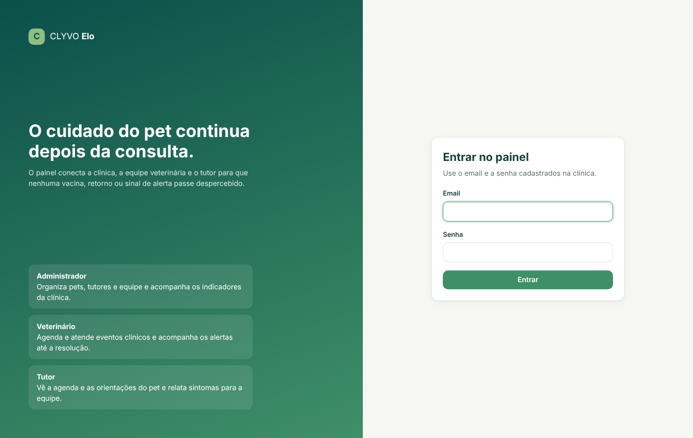 | **Dashboard do administrador** 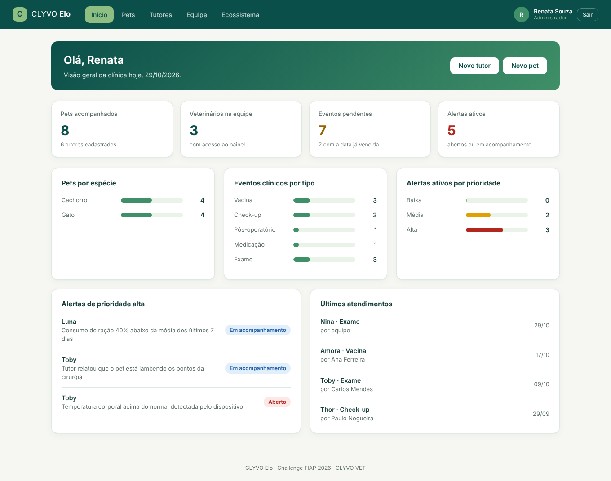 |
| **Agenda do veterinário** 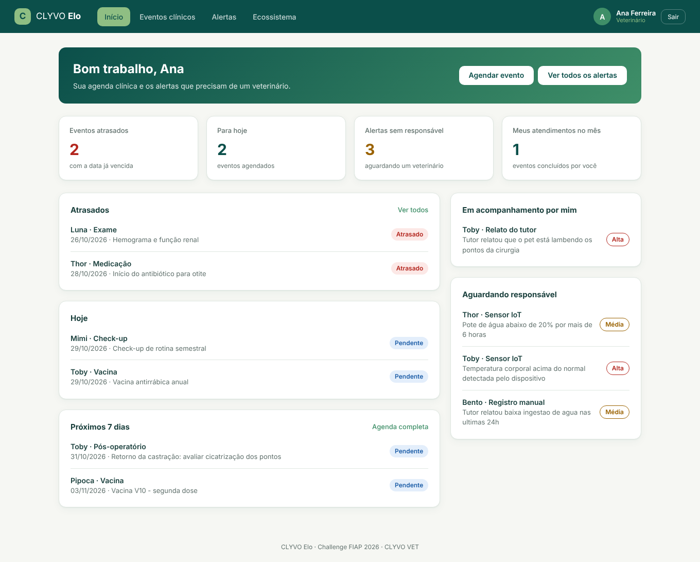 | **Eventos clínicos com filtros** 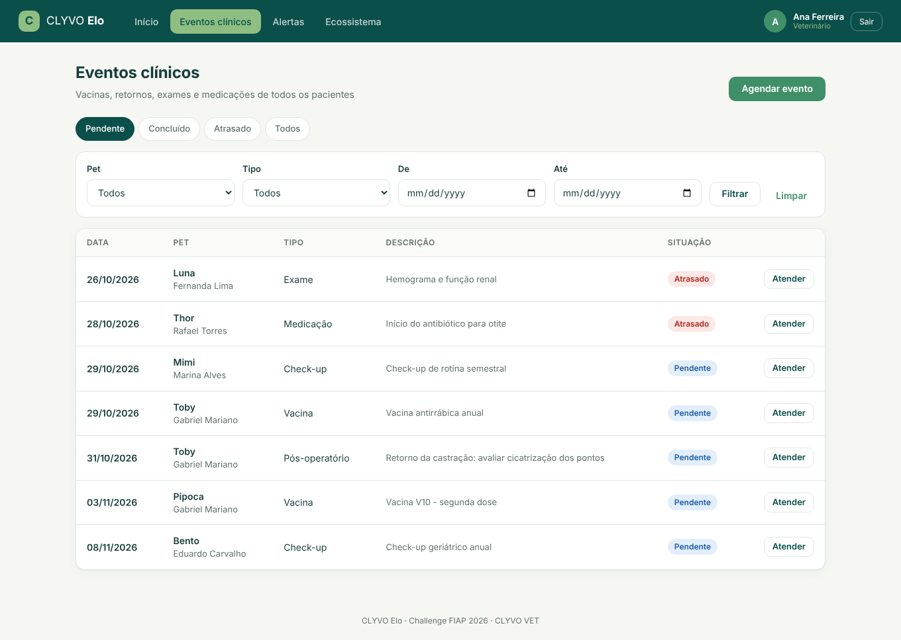 |
| **Atendimento do evento** 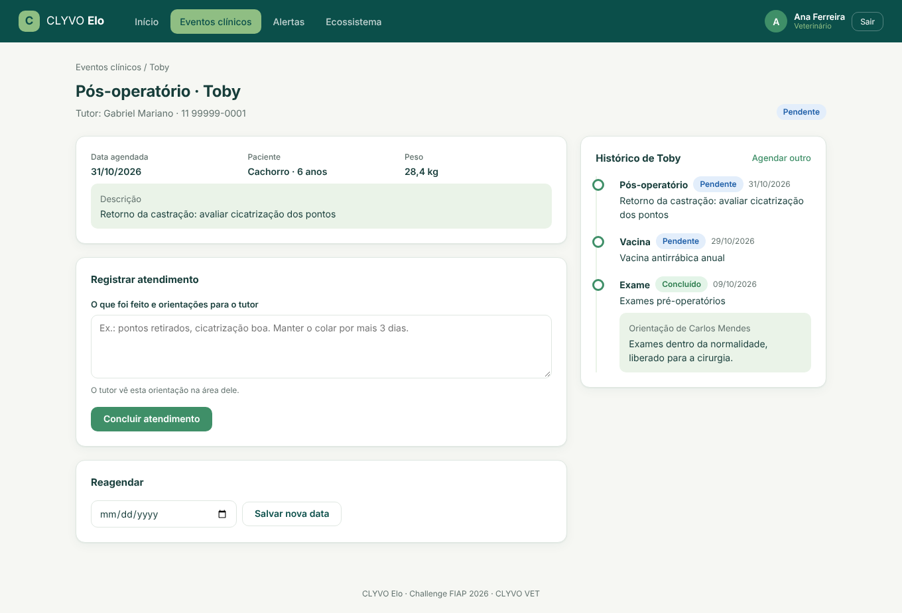 | **Fila de alertas** 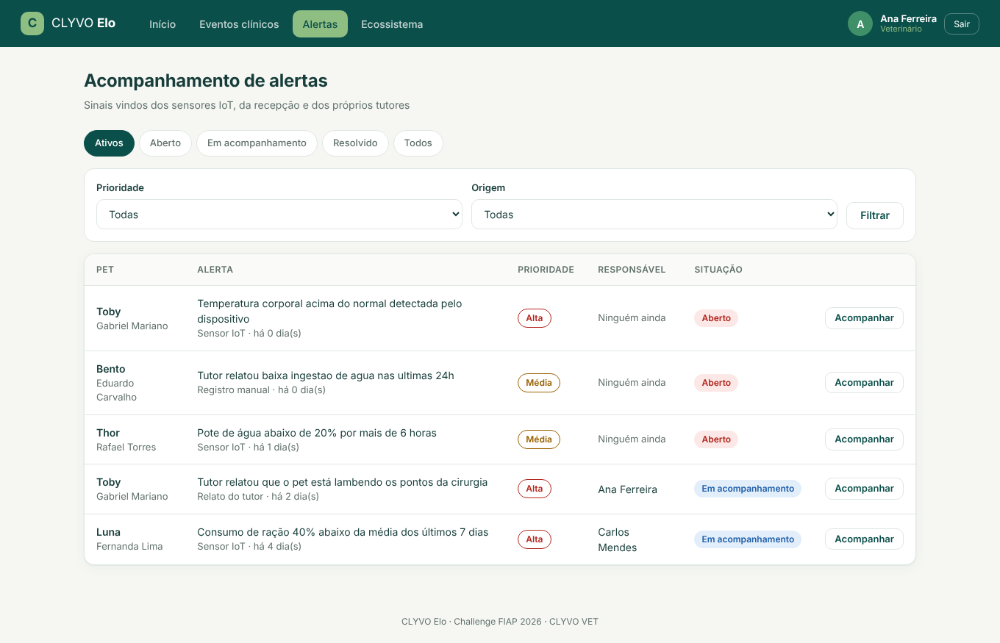 |
| **Acompanhamento do alerta** 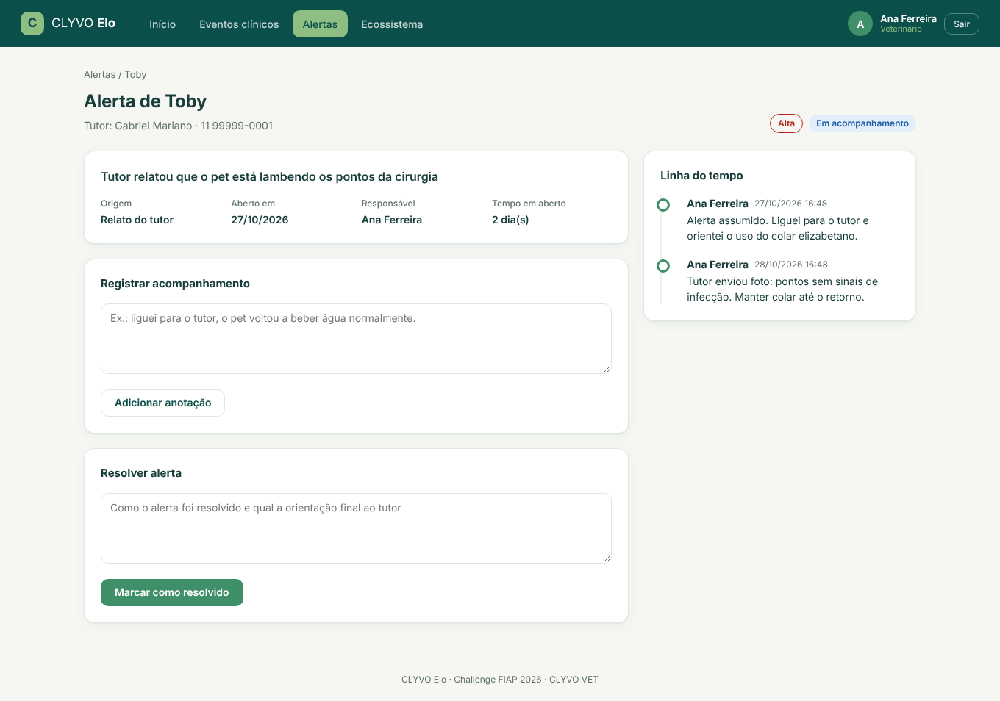 | **Área do tutor** 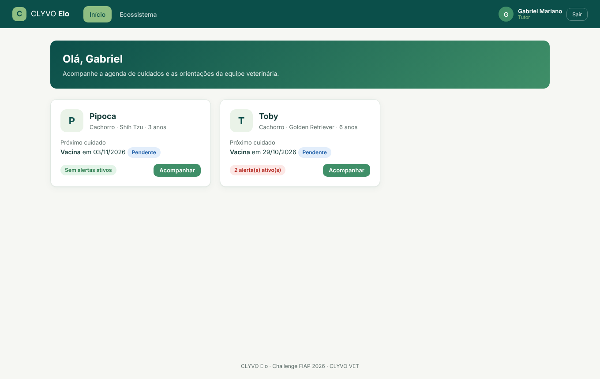 |
| **Pet na visão do tutor** 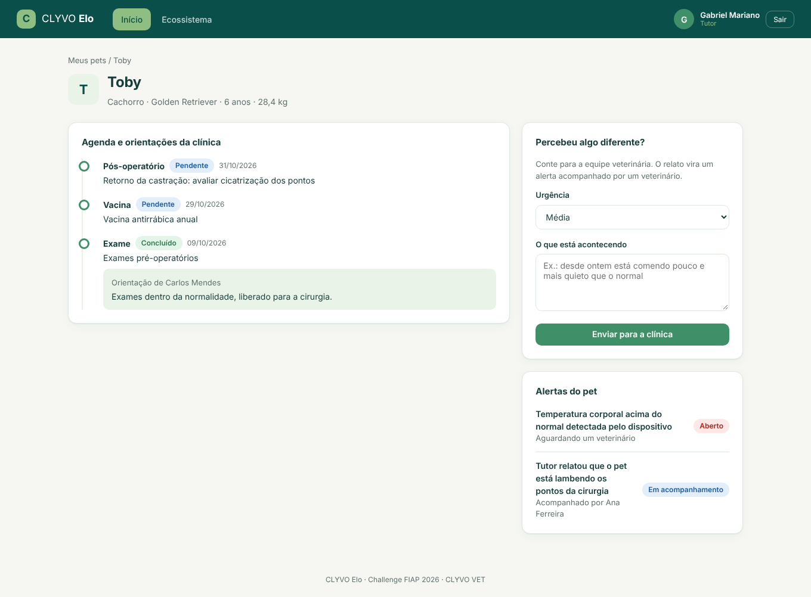 | **Histórico do pet (administrador)** 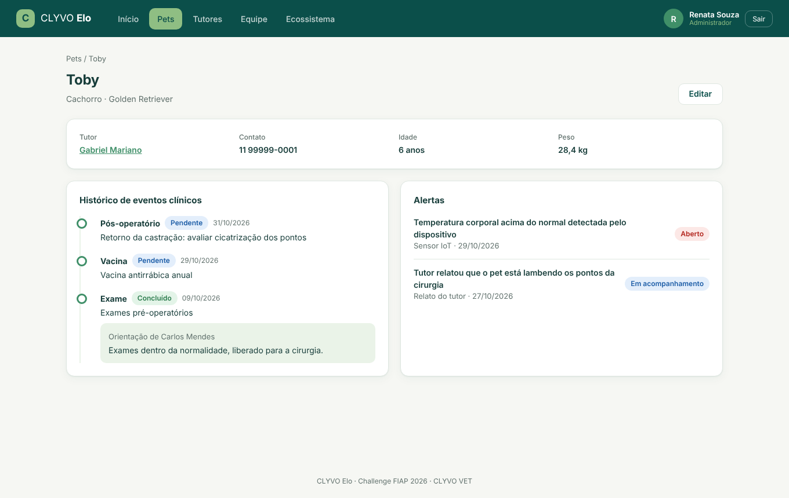 |
| **Ecossistema e integrações** 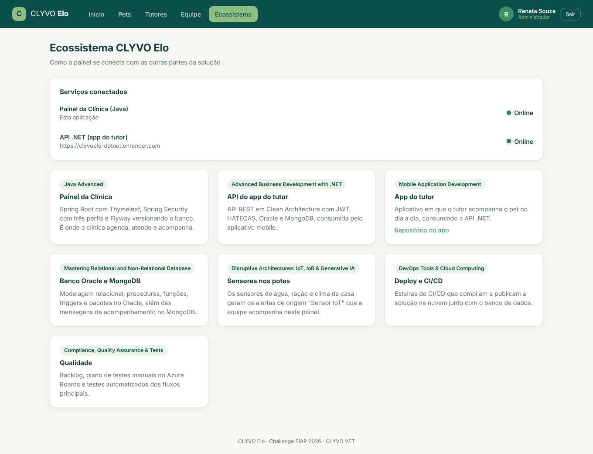 | |

---

## 5. Arquitetura e decisões técnicas

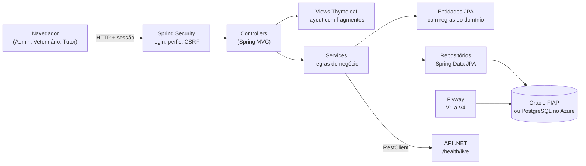

| Camada | Pacote | Responsabilidade |
|---|---|---|
| Configuração e segurança | `config`, `security` | `SecurityFilterChain` com as regras por perfil; `PainelUserDetailsService` autentica funcionários e tutores e monta o `UsuarioAutenticado` |
| Controllers | `controller` | Recebem a requisição, validam o formulário e escolhem a view. Não têm regra de negócio. |
| Services | `service` | Regras de negócio e transações: agendar, atender, assumir, resolver, relatar, montar os dashboards |
| Modelo | `model`, `model.enums` | Entidades JPA com os métodos de domínio (`registrarAtendimento`, `reagendar`, `assumir`, `resolver`, `estaAtrasado`), e enums com o texto exibido na tela |
| Repositórios | `repository` | Spring Data JPA com consultas de filtro em JPQL |
| DTOs e formulários | `dto` | Filtros das listagens, formulários dos fluxos e os dados dos dashboards |
| Exceções | `exception` | `RegraDeNegocioException`, `RecursoNaoEncontradoException` e `GlobalExceptionHandler`, com páginas de erro amigáveis |

### Por que fizemos assim

- **Thymeleaf com fragmentos (`fragments/layout.html`).** O cabeçalho, o menu, as mensagens, as etiquetas de status e as listas que aparecem em várias telas são escritos uma vez só e reaproveitados em todas as páginas.
- **Regras dentro das entidades.** Quem decide se um evento pode ser atendido ou se um alerta pode ser resolvido é a própria entidade. O service orquestra e o controller só conversa com a tela. Assim a regra fica num lugar só e é fácil de testar.
- **Enums em vez de texto solto.** Tipo de evento, status, prioridade, origem e perfil são enums gravados como texto (`@Enumerated(STRING)`), batendo com as restrições `CHECK` do banco, e cada um traz a descrição que aparece na tela.
- **Situação "Atrasado" calculada.** Um evento pendente com a data vencida aparece como atrasado sem precisar de nenhum processo agendado para atualizar o banco.
- **Flyway em vez de `ddl-auto`.** O Hibernate só valida (`ddl-auto=validate`); quem cria e altera o banco são as migrações versionadas.
- **Dois bancos, um código.** O perfil padrão usa o Oracle da FIAP. O perfil `azure` usa PostgreSQL, com as migrações equivalentes em `db/migration-azure`, para o deploy na nuvem da disciplina de DevOps.
- **Status do ecossistema sem travar a página.** A página Ecossistema carrega na hora e consulta o status da API .NET em segundo plano, porque o serviço gratuito pode levar alguns segundos para acordar.

---

## 6. Banco de dados e Flyway

O schema é criado e versionado inteiramente pelo Flyway. Todas as tabelas usam o prefixo `painel_`, para conviver no mesmo usuário Oracle com as tabelas da API .NET.

| Versão | O que faz |
|---|---|
| `V1__criar_tabelas.sql` | Funcionários, pets, eventos clínicos e alertas |
| `V2__dados_demo.sql` | Primeira massa de demonstração (Sprint 3) |
| `V3__perfil_tutor_e_acompanhamento.sql` | Cria `painel_tutor` e migra o antigo `nome_tutor` dos pets para tutores de verdade, sem perder dados; adiciona a data de atendimento, o responsável pelo alerta, o status `EM_ACOMPANHAMENTO` e a tabela `painel_alerta_acompanhamento` |
| `V4__dados_demo_sprint4.sql` | Novos tutores, pets, eventos e alertas, com datas relativas ao dia de hoje para a demonstração estar sempre atual |

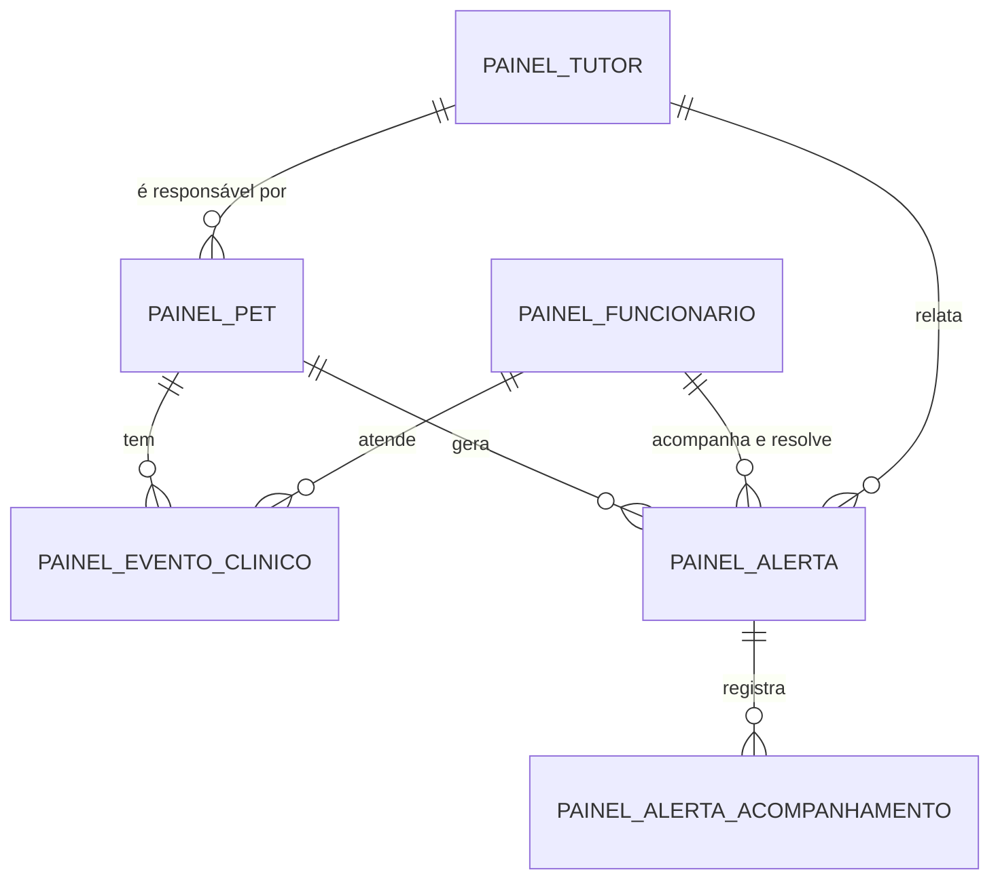

---

## 7. Integração com as outras disciplinas

A página **Ecossistema** (`/ecossistema`) mostra esta integração dentro do próprio painel, inclusive verificando em tempo real se a API .NET está no ar.

| Disciplina | Como aparece na solução | Evidência |
|---|---|---|
| **Java Advanced** | Este painel: Spring Boot, Thymeleaf, Spring Security com três perfis, Flyway, JPA | Este repositório |
| **Advanced Business Development with .NET** | API REST em Clean Architecture (JWT, HATEOAS, Oracle e MongoDB) que atende o app do tutor; o painel consulta a saúde dela | [Repositório](https://github.com/GabrielCabralmm/ClyvoElo-dotnet) · [Swagger](https://clyvoelo-dotnet.onrender.com/swagger) |
| **Mobile Application Development** | App do tutor, que consome a API .NET | [Repositório](https://github.com/GabrielCabralmm/clyvo-elo-mobile) |
| **Mastering Relational and Non-Relational Database** | Modelagem no Oracle, com procedures, funções, triggers e pacotes; as mensagens de acompanhamento ficam no MongoDB. O painel usa o mesmo Oracle da FIAP | Scripts SQL entregues na disciplina |
| **Disruptive Architectures: IoT, IoB & Generative IA** | Os sensores dos potes de água e ração geram os alertas de origem "Sensor IoT" acompanhados aqui | Alertas de origem Sensor IoT no painel |
| **DevOps Tools & Cloud Computing** | Perfil `azure` com PostgreSQL, Dockerfile e esteiras de build e deploy em `.github/workflows` | `application-azure.properties`, `Dockerfile` |
| **Compliance, Quality Assurance & Tests** | Backlog e plano de testes no Azure Boards; os testes automatizados deste projeto cobrem as regras dos fluxos | `src/test` |

---

## 8. Como executar

### Pré-requisitos

- Java 21
- Maven 3.9 ou uma IDE com suporte a Maven (IntelliJ, VS Code)
- Acesso ao Oracle da FIAP **ou** um PostgreSQL

### Com o Oracle da FIAP (perfil padrão)

Informe as credenciais por variável de ambiente (ou edite `src/main/resources/application.properties` só na sua máquina):

```bash
export SPRING_DATASOURCE_USERNAME=RM000000
export SPRING_DATASOURCE_PASSWORD=sua_senha
mvn spring-boot:run
```

No PowerShell:

```powershell
$env:SPRING_DATASOURCE_USERNAME="RM000000"
$env:SPRING_DATASOURCE_PASSWORD="sua_senha"
mvn spring-boot:run
```

A aplicação sobe em **http://localhost:8080**. Na primeira execução, o Flyway cria as tabelas e carrega os dados de demonstração. Não é preciso rodar nada manualmente no banco.

### Com PostgreSQL (perfil `azure`)

```bash
export SPRING_PROFILES_ACTIVE=azure
export SPRING_DATASOURCE_URL=jdbc:postgresql://localhost:5432/clyvoelo
export SPRING_DATASOURCE_USERNAME=clyvo
export SPRING_DATASOURCE_PASSWORD=clyvo
mvn spring-boot:run
```

### Com Docker

```bash
docker build -t clyvo-elo-painel .
docker run -p 8080:8080 -e SPRING_DATASOURCE_USERNAME=RM000000 -e SPRING_DATASOURCE_PASSWORD=sua_senha clyvo-elo-painel
```

### Variáveis de ambiente

| Variável | Para que serve | Padrão |
|---|---|---|
| `SPRING_DATASOURCE_URL` | Endereço do banco | Oracle da FIAP |
| `SPRING_DATASOURCE_USERNAME` / `SPRING_DATASOURCE_PASSWORD` | Credenciais do banco | — |
| `SPRING_PROFILES_ACTIVE` | `azure` para usar PostgreSQL | perfil padrão (Oracle) |
| `PORT` | Porta HTTP (usada pelo Render) | `8080` |
| `CLYVO_API_DOTNET_URL` | Endereço da API .NET verificado na página Ecossistema | `https://clyvoelo-dotnet.onrender.com` |

---

## 9. Testes

```bash
mvn test
```

São 27 testes com JUnit 5, Mockito e AssertJ, que não precisam de banco:

- `model/EventoClinicoTest`, `AlertaTest`, `PetTest`: regras das entidades (atrasado, atendimento único, reagendamento, assumir e resolver alerta, idade e peso formatados, dono do pet);
- `service/AlertaServiceTest`: o tutor não relata alerta de pet de outro tutor; anotar um alerta aberto faz o veterinário assumi-lo;
- `service/CredencialServiceTest`: senha obrigatória, tamanho mínimo, manter a senha na edição e email único entre funcionários e tutores;
- `service/FuncionarioServiceTest` e `EventoClinicoServiceTest`: não excluir a própria conta nem quem tem atendimentos; filtro de atrasados; reagendamento para o passado.

---

## 10. Estrutura do projeto

```
src/main/java/com/clyvoelo/painel/
  config/          SecurityConfig (rotas por perfil, login, logout, CSRF)
  security/        UsuarioAutenticado e PainelUserDetailsService
  controller/      Painel, Pet, Tutor, Funcionario, EventoClinico, Alerta, AreaTutor, Ecossistema
  service/         regras de negócio e montagem dos dashboards
  model/           entidades JPA com os métodos de domínio
  model/enums/     Perfil, Especie, TipoEvento, StatusEvento, StatusAlerta, PrioridadeAlerta, OrigemAlerta
  repository/      Spring Data JPA
  dto/             filtros, formulários e dados dos dashboards
  exception/       exceções e GlobalExceptionHandler

src/main/resources/
  db/migration/          migrações Flyway para Oracle
  db/migration-azure/    migrações Flyway para PostgreSQL
  templates/fragments/   layout, menu e componentes reaproveitados
  templates/dashboard/   tela inicial de cada perfil
  templates/             pets, tutores, funcionarios, eventos, alertas, tutor, ecossistema, login, erro
  static/css/            identidade visual do CLYVO Elo

src/test/java/           testes de modelo e de serviço
docs/telas/              capturas de tela usadas neste README
```

## Stack

- Java 21 e Spring Boot 4.1 (Web MVC, Data JPA, Validation, Security)
- Thymeleaf com `thymeleaf-extras-springsecurity6`
- Flyway (Oracle e PostgreSQL)
- Oracle Database (FIAP) e PostgreSQL (Azure)
- JUnit 5, Mockito e AssertJ
- Docker e GitHub Actions
